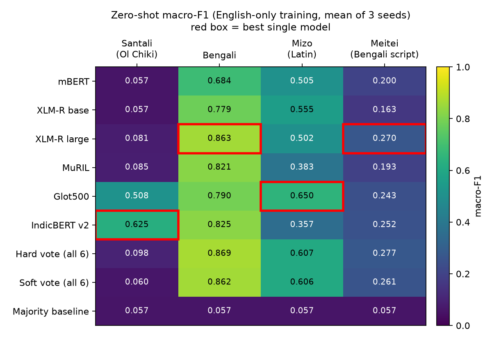

# zero-shot-indic-ensemble

**Zero-shot cross-lingual topic classification for low-resource Indian languages, using an ensemble of multilingual transformers.**

Fine-tune on English. Test on Santali, Bengali, Mizo and Meitei. No labelled examples in any of them.



*The majority-class baseline is 0.057. Meitei scores (0.16 to 0.28) are close to chance for every model, so its red box marks the least bad model, not a good one.*

---

## Contents

1. [What is zero-shot cross-lingual transfer?](#what-is-zero-shot-cross-lingual-transfer)
2. [Project summary](#project-summary)
3. [Repository structure](#repository-structure)
4. [Getting started](#getting-started)
5. [Dataset and method](#dataset-and-method)
6. [Results](#results)
7. [Using the API](#using-the-api)
8. [Testing and reproducibility](#testing-and-reproducibility)
9. [Mundari (exploratory)](#mundari-exploratory)
10. [Acknowledgements and references](#acknowledgements-and-references)
11. [Limitations](#limitations)
12. [Plans for improvement](#plans-for-improvement)

---

## What is zero-shot cross-lingual transfer?

Most language technology is built for a few dozen languages that have plenty of text and labelled data. India has hundreds of languages, and many of them, including tribal languages such as Santali, have almost no labelled data for tasks like text classification. Training a separate classifier for each one is not realistic.

**Zero-shot cross-lingual transfer** is a way around that. A multilingual model such as XLM-R is first pretrained on raw text from many languages. We then teach it a task using labelled data in *one* language, usually English, and ask it to perform the same task in *another* language it was never taught on. "Zero-shot" means zero labelled examples in the target language.

```
 English sentences + topic labels  ──►  fine-tune a multilingual model
                                                    │
                                                    ▼
        Santali / Bengali / Mizo / Meitei sentences  ──►  predicted topic
        (the model has never seen a labelled example in these languages)
```

It can work because multilingual pretraining tends to place sentences with similar meanings near each other, whatever the language. It can fail when the model never saw the language, or when its tokenizer cannot even read the script. This project measures when each outcome happens.

---

## Project summary

The task is seven-way topic classification: science/technology, travel, politics, sports, health, entertainment and geography. The data comes from SIB-200, a human-annotated benchmark that is parallel across more than 200 languages, so the same sentence exists in English, Santali, Bengali, Mizo and Meitei with the same label.

The project asks three questions:

1. **Which models transfer best to which languages?** Six multilingual transformers are compared: mBERT, XLM-R base, XLM-R large, MuRIL, Glot500 and IndicBERT v2.
2. **Does combining models help?** Three ensembles (hard vote, soft vote and validation-weighted soft vote) are compared with every individual model, with exact McNemar significance tests.
3. **What actually drives transfer: model size, or whether the model has seen the language and its script?** A tokenizer-coverage analysis and four contrasting test languages are used to separate those explanations.

The four test languages were chosen on purpose:

| Language | Family | Script | Role in the study |
|---|---|---|---|
| Bengali | Indo-European | Bengali | Control: a well-resourced language |
| Mizo | Sino-Tibetan | Latin | A new language written in a script every tokenizer can read |
| Meitei | Sino-Tibetan | Bengali | A new language in a script the models know |
| Santali | Austroasiatic | Ol Chiki | A new script and a new language |

Everything was run on a single laptop GPU (RTX 4060, 8 GB). A FastAPI service then serves the best model for each language, with the benchmark evidence attached to every response.

---

## Repository structure

```
zero-shot-indic-ensemble/
├── app/                           FastAPI inference service
│   ├── __init__.py
│   ├── classifier.py
│   ├── main.py
│   ├── routing.py
│   └── script_detect.py
├── outputs/
│   ├── figures/                   results figure used in this README
│   ├── models/                    fine-tuned checkpoints for the API (git-ignored)
│   ├── predictions/               saved softmax outputs, 6 models x 3 seeds
│   └── tables/                    every result table as CSV
├── tests/
│   ├── test_ensemble.py
│   └── test_api.py
├── check_export.py
├── check_gpu.py
├── check_serving.py
├── check_tokenizer_coverage.py
├── compare.py
├── compare_translation.py
├── config.py
├── data_utils.py
├── ensemble.py
├── evaluate.py
├── make_figure.py
├── models.py
├── mundari_extension.py
├── train.py
├── try_api.py
├── requirements.txt
├── requirements-api.txt
└── README.md
```

### Core pipeline

| File | What it does |
|---|---|
| `config.py` | The single source of truth: paths, the dataset id, the four test languages, the seven labels, the registry of six models (with their Hugging Face ids and any per-model overrides), training defaults and the three random seeds. Changing a setting here changes it everywhere. |
| `data_utils.py` | Loads the SIB-200 splits from the Hugging Face Hub and checks the labels. English train and validation are the only labelled data any model learns from; the test languages are reachable only through a separate loader, which keeps the evaluation genuinely zero-shot. Results are cached. |
| `models.py` | Builds the tokenizer and a classification model for any entry in the registry, and picks the GPU when one is available. A new randomly initialised classification head is added on top of each pretrained encoder. |
| `evaluate.py` | Runs a model over sentences in batches and returns softmax probabilities, then computes accuracy and macro-F1. Probabilities (not just predicted classes) are kept because soft voting needs them. |
| `train.py` | Fine-tunes one model on English only: AdamW, linear warm-up and decay, bf16 mixed precision and gradient accumulation. The best epoch is chosen on English validation, never on a test language. It then evaluates zero-shot on all four languages and saves the probabilities. `--smoke` does a one-epoch test, and `--export` saves checkpoints for the API. |
| `ensemble.py` | Hard, soft and weighted soft voting as small NumPy functions. Hard voting breaks ties by summed confidence, and weights are validated (finite, non-negative, one per model). Covered by six unit tests. |
| `compare.py` | The analysis script. It aggregates all runs into mean and standard deviation over seeds, per-class F1, exact McNemar tests (best ensemble against the best single model by macro-F1 and by accuracy) and leave-one-out ablations, and writes everything to `outputs/tables/`. |

### Diagnostics and extensions

| File | What it does |
|---|---|
| `check_tokenizer_coverage.py` | Measures, for each tokenizer and language, how many tokens are unknown (`[UNK]`) and how heavily words are split into pieces. This is the evidence that four of six models cannot read Ol Chiki. |
| `make_figure.py` | Draws the macro-F1 heatmap from the result tables. |
| `mundari_extension.py` | An exploratory pipeline that translates text into English with NLLB-200 and then classifies it with an English-trained model. It is validated on Santali, where labels exist. |
| `compare_translation.py` | A paired McNemar test of the translate-then-classify route against the direct zero-shot models on Santali. |
| `check_export.py` | Confirms that the checkpoints re-trained for the API reproduce the original predictions exactly. |
| `check_serving.py` | Tests how batch size and numeric precision change predictions of the served models. This is how the one-sentence difference in the API was traced to numerical noise. |
| `check_gpu.py` | A quick check that PyTorch sees the GPU. |
| `try_api.py` | Sends the full test sets through a running API and compares accuracy with the training logs. |

### API (`app/`)

| File | What it does |
|---|---|
| `script_detect.py` | Identifies the dominant writing system of a text from Unicode character names, with no model needed. Ol Chiki can only be Santali, so it is the one unambiguous signal. |
| `routing.py` | The route table: which model serves which language, with its benchmark score and a reliability label. It also holds the rules for auto-detection and for the warnings returned to the caller. |
| `classifier.py` | Loads models lazily and keeps at most two in memory (least recently used is dropped first), then runs batched inference. |
| `main.py` | The FastAPI application with `/classify`, `/languages` and `/health`, request validation and meaningful error codes. |

---

## Getting started

**Requirements:** Python 3.11 and an NVIDIA GPU with at least 8 GB of memory for training. The saved predictions let you regenerate every table without a GPU.

```bash
git clone https://github.com/auric858/zero-shot-indic-ensemble.git
cd zero-shot-indic-ensemble

conda create -n indic python=3.11 -y
conda activate indic

# Install PyTorch with CUDA first; a plain "pip install torch" gives the CPU-only build
pip install torch --index-url https://download.pytorch.org/whl/cu124
pip install -r requirements.txt

python check_gpu.py          # should print: CUDA available : True
```

The versions used for the reported results are Python 3.11, PyTorch 2.6.0 (CUDA 12.4), `transformers` 4.57.6 and `huggingface-hub` 0.36.2. The hub library is pinned below 1.0 in `requirements.txt` because `transformers` 4.57 does not import with newer releases.

### Reproduce the results

```bash
python -m pytest tests -q                 # 15 tests
python data_utils.py                      # sanity-check dataset sizes: 701 / 99 / 204
python check_tokenizer_coverage.py

python train.py --models mbert xlmr_base muril glot500 indicbert_v2 --seeds 42 43 44
python train.py --models xlmr_large --seeds 42 43 44

python compare.py                         # tables go to outputs/tables/
python make_figure.py
```

Training is resumable: a finished run is skipped if you start the command again. The whole set takes about 30 minutes on an RTX 4060 laptop GPU. If you only want to rebuild the tables, skip the two `train.py` lines; the predictions are already in `outputs/predictions/`.

---

## Dataset and method

**Data.** SIB-200 (Adelani et al., 2024) adds human-annotated topic labels to the FLORES-200 parallel corpus. Splits used here:

| Split | Language | Sentences | Used for |
|---|---|---|---|
| Train | English | 701 | Fine-tuning |
| Validation | English | 99 | Choosing the best epoch and the ensemble weights |
| Test | Santali, Bengali, Mizo, Meitei | 204 each | Zero-shot evaluation only |

**The zero-shot rule.** No sentence in any test language is used for training, for choosing a checkpoint or for setting an ensemble weight. Ensemble weights come from each model's English validation macro-F1. The majority-class baseline is computed from English training labels.

**Models.** mBERT, XLM-R base, XLM-R large, MuRIL, Glot500 and IndicBERT v2. XLM-R large is trained with its word embeddings frozen so that it fits in 8 GB of GPU memory.

**Ensembles.**

- *Hard vote:* each model votes for its top class; the majority wins and ties are broken by total confidence.
- *Soft vote:* average the six probability vectors, then take the top class.
- *Weighted soft vote:* the same, with each model weighted by its English validation macro-F1.

**Evaluation.** Accuracy, macro-F1 and per-class F1, averaged over three seeds (42, 43, 44). Macro-F1 is the headline measure because it counts all seven classes equally. Significance is tested with exact McNemar tests, since a 204-sentence test set can make small gaps look larger than they are.

---

## Results

### Macro-F1 by model and language (mean of 3 seeds)

| System | Santali | Bengali | Mizo | Meitei |
|---|---|---|---|---|
| mBERT | 0.057 | 0.684 | 0.505 | 0.200 |
| XLM-R base | 0.057 | 0.779 | 0.555 | 0.163 |
| XLM-R large | 0.081 | **0.863** | 0.502 | 0.270 |
| MuRIL | 0.085 | 0.821 | 0.383 | 0.193 |
| Glot500 | 0.508 | 0.790 | **0.650** | 0.243 |
| IndicBERT v2 | **0.625** | 0.825 | 0.357 | 0.252 |
| Hard vote (all 6) | 0.098 | 0.869 | 0.607 | 0.277 |
| Soft vote (all 6) | 0.060 | 0.862 | 0.606 | 0.261 |
| Majority-class baseline | 0.057 | 0.057 | 0.057 | 0.057 |

Bold marks the best single model per language. Weighted soft voting was almost identical to plain soft voting, because the English validation scores that supply the weights range only from 0.84 to 0.89. Standard deviations across seeds are typically 0.01 to 0.05; accuracy and per-class scores are in `outputs/tables/`.

### Why four models fail on Santali: tokenizer coverage

Share of tokens that become `[UNK]` (the tokenizer's "unknown" placeholder) on the 204 test sentences:

| Model | Santali | Bengali | Mizo | Meitei |
|---|---|---|---|---|
| mBERT | 94.0% | 3.0% | 0% | 2.8% |
| XLM-R (base and large) | 48.8% | 0% | 0% | 0% |
| MuRIL | 94.0% | 0% | 0.2% | 0% |
| Glot500 | 0% | 0% | 0% | 0% |
| IndicBERT v2 | 0% | 0% | 0% | 0% |

For XLM-R, every Santali word becomes a placeholder plus a word marker, which is why the rate looks like 49% while the content is in effect lost. mBERT and XLM-R base score exactly at the majority-class baseline on Santali because they give the same answer for every sentence.

### Key findings

1. **The best model depends on the language, and follows pretraining coverage.** XLM-R large wins on Bengali, Glot500 on Mizo and IndicBERT v2 on Santali. IndicBERT v2 is first on Santali and close to last on Mizo.
2. **Model size does not make up for missing coverage.** XLM-R large is the strongest single model on Bengali and is at the baseline on Santali.
3. **Averaging models did not beat the best single model.** It was clearly worse on Santali and Mizo, and statistically tied on Bengali and Meitei (table below).
4. **Ensembling only helps when the members can read the input.** On Santali, an ensemble of just the two models whose tokenizers cover Ol Chiki (Glot500 and IndicBERT v2) reaches 0.56, against 0.06 to 0.10 for all six, though still below IndicBERT v2 alone (0.625). Removing the two constant-output models (mBERT and XLM-R base) raised the all-model hard vote from 0.098 to about 0.2.
5. **Meitei stayed near chance for every model** (macro-F1 0.16 to 0.28), even though its Bengali script is readable by all of them. The data here cannot say whether the cause is the language, its heavy word fragmentation or both.
6. **Translation is a competitive alternative for Santali.** Translating with NLLB-200 and classifying in English gave 0.701 accuracy (macro-F1 0.667), significantly better than direct Glot500 and not distinguishable from direct IndicBERT v2. Because NLLB was trained with supervised Santali–English data, this is not a zero-shot result.

### Significance tests: best ensemble against best single model

Exact McNemar test per seed (42 / 43 / 44). A small p-value means the two systems differ; the counts show which one is better.

| Language | Compared with | p-values | Reading |
|---|---|---|---|
| Santali | IndicBERT v2 | < 0.0001 for all seeds | Ensemble clearly worse |
| Bengali | XLM-R large | 0.80 / 0.12 / 0.33 | No difference |
| Mizo | Glot500 | 0.64 / 0.005 / 0.020 | Ensemble worse or tied |
| Meitei | XLM-R large (best by F1) | 0.68 / 0.18 / 0.0016 | Mixed |
| Meitei | IndicBERT v2 (best by accuracy) | 0.076 / 0.22 / 0.83 | No difference |

On Meitei, one seed showed a significant gain over XLM-R large, but it disappears against IndicBERT v2, the most accurate single model there. The three seeds share the same 204 sentences, so these p-values are not independent tests and should be read as consistency checks.

**Translate-then-classify against direct transfer on Santali** (p-values per seed):

| Direct model | p-values | Reading |
|---|---|---|
| IndicBERT v2 | 0.38 / 0.053 / 0.12 | Not significantly different |
| Glot500 | 0.0001 / < 0.0001 / < 0.0001 | Translation clearly better |

### Output files

Everything above is stored in `outputs/`:

| Path | Contents |
|---|---|
| `outputs/figures/f1_heatmap.png` | The results figure |
| `outputs/predictions/` | 18 `.npz` files (6 models x 3 seeds) holding the softmax probabilities, labels and English validation F1 |
| `outputs/tables/main_results_<language>.csv` | Accuracy and macro-F1, mean and standard deviation over seeds |
| `outputs/tables/per_class_f1_<language>.csv` | F1 for each of the seven topics |
| `outputs/tables/mcnemar_<language>.csv` | The significance tests |
| `outputs/tables/ablations_<language>.csv` | Ensembles built from different subsets of models |
| `outputs/tables/tokenizer_coverage.csv` | Unknown-token rate and fragmentation per tokenizer and language |
| `outputs/tables/mcnemar_translate_vs_direct_santali.csv` | The translation comparison |

---

## Using the API

The service serves the best model per language and states how far to trust each answer.

| Language | Model | Reliability | Benchmark basis |
|---|---|---|---|
| Santali | IndicBERT v2 | moderate | macro-F1 0.625 |
| Mizo | Glot500 | moderate | macro-F1 0.650 |
| Bengali | XLM-R large | good | macro-F1 0.863 |
| English | XLM-R large | good | English validation macro-F1 0.876 |
| Meitei | IndicBERT v2 | **low**, with a warning | near chance |

**Start it.** The weights are not stored in the repository, so first save checkpoints for the three serving models (about 5 GB, 15 to 20 minutes). This retrains the seed-42 models, which reproduces the reported predictions exactly:

```bash
python train.py --models indicbert_v2 glot500 xlmr_large --seeds 42 --export
pip install -r requirements-api.txt
uvicorn app.main:app --port 8000
```

Interactive documentation is at `http://127.0.0.1:8000/docs`.

**Classify text:**

```python
import requests

reply = requests.post(
    "http://127.0.0.1:8000/classify",
    json={"texts": ["The nucleus is made up of two particles."]},   # language defaults to "auto"
).json()
print(reply["predictions"][0]["label"], reply["model"], reply["warnings"])
```

The response has this shape (abridged):

```json
{
  "language": "english",
  "script": "latin",
  "model": "xlmr_large",
  "reliability": "good",
  "benchmark": "English validation macro-F1 0.876 (99 sentences)",
  "warnings": ["Latin-script text was assumed to be English. Pass language='mizo' for Mizo."],
  "predictions": [{"label": "...", "confidence": 0.0, "probabilities": {"...": 0.0}}]
}
```

**How language is chosen.** In `auto` mode the service reads the writing system. Ol Chiki is unambiguous and is routed to Santali. Bengali script is also used by Meitei and Assamese, and Latin script covers both English and Mizo, so those two scripts are assumed to be Bengali and English and a warning says so. Pass `"language": "mizo"` or `"language": "meitei"` to override. Text in an unsupported script, or a request mixing languages, gets a clear 422 error instead of a guess. If a model's checkpoint is not installed, the API returns 503.

The served checkpoints are the exact seed-42 models. The API reproduces their benchmark accuracy to within one or two sentences out of 204; the remaining difference comes from batch size and numeric precision, not from the weights (see `check_serving.py`).

---

## Testing and reproducibility

- **15 automated tests:** 6 for the ensemble logic (majority recovery, hard-vote majority, confidence tie-breaking, weight handling, probability normalisation and rejection of invalid weights) and 9 for the API (script detection, routing, validation, error codes), using a stand-in model store. Run them with `python -m pytest tests -q`.
- **Deterministic training.** Re-running with the same seeds produced identical predictions on 100% of test sentences for every model checked, so every reported number can be regenerated.
- **Saved predictions** are committed, so `python compare.py` rebuilds every table without a GPU.
- **Serving checks.** `check_export.py` and `try_api.py` verify that the served models match the benchmark runs.

---

## Mundari (exploratory)

Mundari has no public labelled classification benchmark, and NLLB-200 has no Mundari language code. For that reason it is **not** part of the results above and no Mundari accuracy is claimed.

`mundari_extension.py` provides a demonstration pipeline: translate the text into English through a proxy source language, then classify the English with an English-trained model. It always shows the translation next to the prediction so a reader can see when the translator failed. The route was validated on Santali, where NLLB is supported and real labels exist (finding 6). That says the route works for a supported language; it says nothing about Mundari itself.

```bash
python mundari_extension.py --demo-santali                                # labelled validation
python mundari_extension.py --csv my_text.csv --text-col mundari --src hin_Deva
```

The `--src` code must match the script of the input (for example `hin_Deva` for Devanagari). A paired CSV with ready-made English can be passed with `--english-col` to skip translation.

---

## Acknowledgements and references

<The experimental design builds on a midterm project report by NAME, INSTITUTION, under the guidance of GUIDE. The code, the additional test languages, the analysis and the API in this repository are my own work.>

**Data and models.** SIB-200 is built on FLORES-200; models come from the Hugging Face Hub.

1. Adelani, D. I., et al. (2024). *SIB-200: A Simple, Inclusive, and Big Evaluation Dataset for Topic Classification in 200+ Languages and Dialects.* EACL 2024. [arXiv:2309.07445](https://arxiv.org/abs/2309.07445)
2. Devlin, J., et al. (2019). *BERT: Pre-training of Deep Bidirectional Transformers for Language Understanding.* NAACL-HLT.
3. Conneau, A., et al. (2020). *Unsupervised Cross-lingual Representation Learning at Scale.* ACL.
4. Khanuja, S., et al. (2021). *MuRIL: Multilingual Representations for Indian Languages.* [arXiv:2103.10730](https://arxiv.org/abs/2103.10730)
5. Imani, A., et al. (2023). *Glot500: Scaling Multilingual Corpora and Language Models to 500 Languages.* ACL.
6. Doddapaneni, S., et al. (2023). *Towards Leaving No Indic Language Behind: Building Monolingual Corpora, Benchmark and Models for Indic Languages.* ACL.
7. NLLB Team (2022). *No Language Left Behind: Scaling Human-Centered Machine Translation.* [arXiv:2207.04672](https://arxiv.org/abs/2207.04672)
8. McNemar, Q. (1947). *Note on the sampling error of the difference between correlated proportions or percentages.* Psychometrika, 12(2), 153-157.

**License.** <Choose a license for the code, for example MIT.> The dataset and models keep their own licences; see their pages on the Hugging Face Hub.

---

## Limitations

- **Small test sets.** Each language has 204 sentences. Differences below about one point are within noise, and changing batch size or precision flips one or two borderline sentences.
- **Non-independent significance tests.** The three seeds are evaluated on the same sentences, so the per-seed p-values are consistency checks and are not independent tests. With many comparisons, one or two p-values near 0.05 are expected by chance.
- **Only one task and one domain.** SIB-200 sentences are short, encyclopaedic and parallel across languages. Borrowed technical terms (for example "genetic variation" appears in Mizo and, phonetically, in Meitei) may make the topic easier to guess than real-world text would. The per-class results do not point to a single class doing all the work, but the effect was not tested directly.
- **English-only ensemble weights.** Keeping the evaluation zero-shot means weights cannot reflect how well a model reads the target language. Weighted and plain soft voting were nearly identical for this reason.
- **Pretraining coverage is not fully verified.** Which languages each model saw in pretraining is inferred from tokenizer behaviour and published documentation. <Check the Glot500 and IndicBERT v2 language lists and state here what you confirmed.>
- **Meitei is unexplained.** Near-chance performance with a readable script could come from the language being unseen, from heavy word fragmentation, or from both; this data cannot separate them.
- **API routing was chosen after seeing the test results**, so the API's reported reliability is descriptive and not a held-out estimate.
- **The translation comparison is a single run** with one classifier checkpoint, on text from NLLB's own benchmark domain, so it is favourable to translation. It is not zero-shot, and says nothing about Mundari.
- **No labelled Mundari data.** Mundari remains a demonstration only.

---

## Plans for improvement

- **Stronger statistics.** More seeds, bootstrap confidence intervals and a correction for multiple comparisons.
- **More languages from SIB-200.** Magahi, Bhojpuri, Maithili and Chhattisgarhi would test related languages, and Kashmiri in both Arabic and Devanagari script would give a clean experiment that varies only the script.
- **Explain Meitei.** An error analysis, and a comparison of word fragmentation against accuracy across all languages, to separate the language effect from the tokenizer effect.
- **Better ensembling.** Gating by script or per-language confidence, so that models that cannot read the input are excluded, and weights tuned on a small labelled development set in the target language if one becomes available.
- **Use unlabelled target-language text.** Parameter-efficient adaptation (adapters or LoRA) of the models that can read Santali, using raw Santali text.
- **A real Mundari evaluation.** A small labelled set built with a Mundari speaker, with the translate-then-classify route and direct transfer both tested on it, and an optional Mundari endpoint in the API.
- **Check other tasks and domains.** Run the same protocol on a second task, and on text outside the encyclopaedic style of FLORES.
- **Better language detection in the API** for Latin-script languages (English versus Mizo), and a Docker image with continuous integration.
